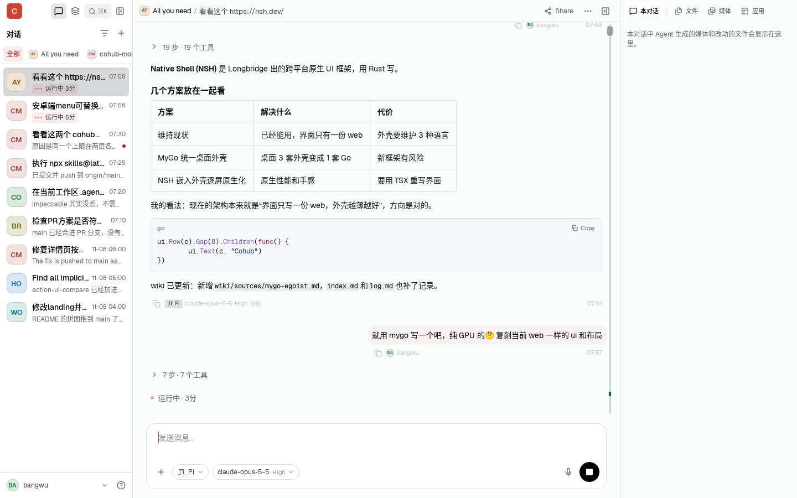
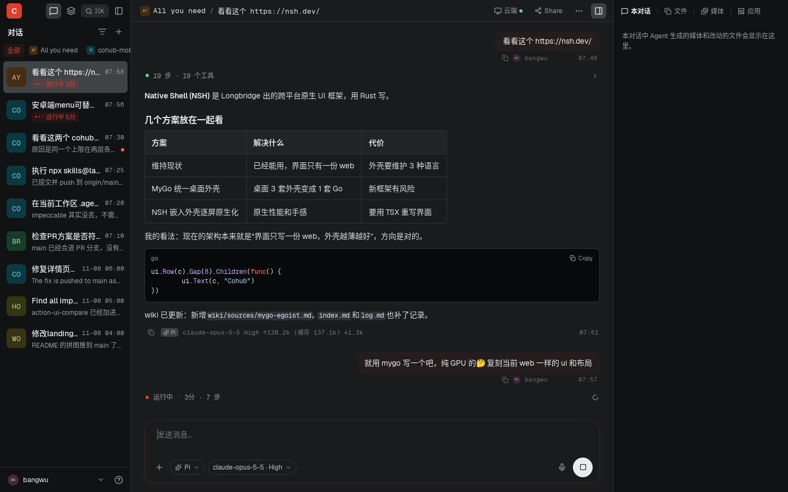
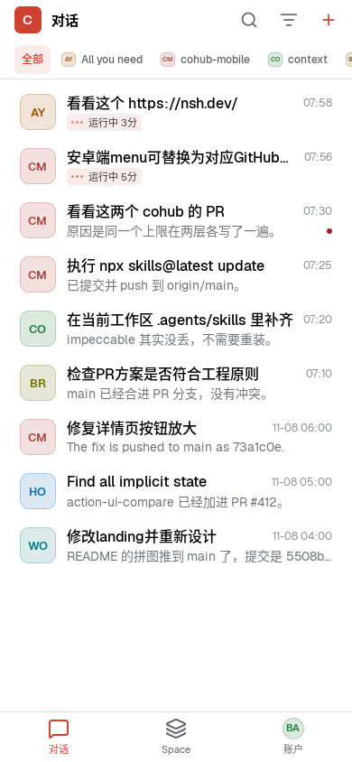

# cohub-mygo

这是 Cohub 的桌面客户端：用 [MyGo](https://mygo.egoist.dev) 的 native UI 按 cohub.live web 的 `(app)` 布局、文案和外观重新实现，界面全部由 MyGo 在 GPU 上绘制（macOS 用 Metal，Windows 用 D3D11，Linux 用 OpenGL）。

- 不使用 WebView、HTML 或 JS，纯 Go 实现，不依赖 cgo（`CGO_ENABLED=0`）。
- 路由和 web 的 URL 一一对应（`/sessions/:id`、`/spaces/:id/sessions/:sid`、`/settings/billing?tab=plans` 等）。
- 文案直接读 web 的 Paraglide 消息（`i18n/zh-CN.json`、`i18n/en.json`），中英文和 web 一致。
- 主题在运行时解析 web 的主题 CSS（`themes/*.css`，oklch / color-mix / var()），还会套用 Home Space 的 `.cohub/theme.css` 自定义主题。
- 账号沿用 `cohub` CLI 的登录状态（`~/.config/cohub/auth.json`，token 过期时调用 `cohub auth token` 刷新）。没有登录时显示演示数据。

| 浅色 | 深色 | 窄窗口（< 768） |
|---|---|---|
|  |  |  |

## 安装

macOS / Linux 一行安装（自动选择 x64 / ARM64，验证 Ed25519 签名）：

```sh
curl -fsSL https://github.com/markbang/cohub-mygo/releases/latest/download/install.sh | sh
```

也可以使用仓库里的入口脚本：

```sh
curl -fsSL https://raw.githubusercontent.com/markbang/cohub-mygo/main/install.sh | sh
```

Linux 安装到 `~/.local/cohub-mygo.app`，命令是 `~/.local/bin/cohub-mygo`，同时注册桌面入口；系统需要 GTK 3 和 OpenSSL 3。macOS 安装到 `/Applications`，没有写入权限时使用 `~/Applications`。

Windows PowerShell：

```powershell
irm https://github.com/markbang/cohub-mygo/releases/latest/download/install.ps1 | iex
```

也可从 [Releases](https://github.com/markbang/cohub-mygo/releases) 下载 macOS DMG、Windows 安装器，或 Linux `.deb` / `.tar.gz`。v0.0.1 的 macOS 包使用临时签名、未经 Apple 公证，Windows 安装器没有代码签名证书；直接下载安装包时，系统可能显示来源确认提示。

卸载（保留用户配置）：

```sh
curl -fsSL https://github.com/markbang/cohub-mygo/releases/latest/download/install.sh | sh -s -- --uninstall
```

账号使用 [Cohub CLI](https://cohub.live/docs) 的登录状态；先安装 CLI 并运行 `cohub auth login`。客户端也可以发起 CLI 的设备登录。

## 从源码运行

```sh
CGO_ENABLED=0 go run .         # 使用 cohub CLI 的账号
COHUB_DEMO=1 go run .          # 演示数据
go tool mygo dev              # 改代码后自动重启
go tool mygo build            # 打包 DMG / Windows 安装器 / Linux deb 与 tar.gz
```

需要 Go 1.27.3+。Linux 上还需要 GTK 3。

## 已复刻的部分

| web | 这里 |
|---|---|
| 左上 rail：Logo、对话 / Space 切换、⌘K、收起侧栏（52px 收起栏） | `sidebar.go` `sidebarTop`、`collapsedRail` |
| 对话侧栏：来源筛选（默认 Web App，含已归档）、最近 6 个 Space 的 chips、会话行、账户菜单 | `chatsSidebar`、`sourcePicker`、`chipBar`、`accountRow` |
| Space 目录：最近 / 全部 / 我的 / 置顶 / 已归档（按加入时间排序）、身份色头像和首字母、行菜单（置顶、归档、钱包、设置） | `spaces.go`、`widgets.go` `avatarSeed` |
| 单个 Space：切换器、新建对话、设置 / 活动 / 存档、标签、按来源分组的对话、应用、存档点、定时、任务 | `sidebar.go` `spaceSidebar`、`space.go` |
| 会话：面包屑、用户气泡、步骤和工具过程、思考折叠、Markdown 回复、模型和 token 统计、流式运行、右侧 turn 导航条、回到最新 | `session.go` |
| Composer：多行输入（Enter 发送）、harness / 模型选择对话框（档位、价格、视觉）、发送 / 停止 | `session.go` |
| ⌘K 命令面板和 Space 选择器 | `palette.go` |
| 右侧面板：本对话（生成的媒体、改动的文件）、文件树、媒体网格（按类型筛选）、应用、定时 | `view.go` `rightPanel`、`media.go`、`space.go` |
| 窗口：文件、存档点、任务、定时任务详情 | `space.go` |
| Space 设置：资料、访问、环境变量（值打码）、渠道、沙箱、钱包 | `spacesettings.go` |
| 设置：常规（主题、语言）、活动（热力图、排行）、邀请、账单（余额 / 方案 / 兑换）、用户规则、渠道 | `settings.go`、`activity.go`、`billing.go`、`purchase.go` |
| 新建 Space | `newspace.go` |
| 窄窗口：列表页头、chips、大号会话行、底部 tab 栏、全屏会话页、侧面板浮层、抽屉 | `compact.go` |
| 实时：订阅 `wss://gateway.cohub.live/ws` 的 `space:<id>`，收到事件后重新拉取 | `realtime.go` |
| 附件、语音输入、"/" 提示词和技能、"@" 提及 Space | `attach.go`、`voice.go`、`composermenus.go` |
| 对话操作：重命名、分享、统计、标签、fork 树、审批、存档点 | `sessionactions.go`、`forktree.go`、`approvals.go`、`checkpoint.go` |
| 文件：编辑保存、新建 / 重命名 / 删除 / 上传、Board、打开方式（App 的 fileHandlers 和 `.cohub/apps.json`） | `files.go`、`board.go`、`openwith.go` |
| 发布 App（文件、目录、端口）、App 面板与详情、已安装 App | `publish.go`、`apps.go` |
| 端口和 display 窗口、本地 Runtime 状态、desktop 命令 | `ports.go`、`display.go`、`runtimestatus.go`、`desktop.go` |
| Space 商务、钱包、Space 设置编辑、邀请页 | `commerce.go`、`wallet.go`、`spacesettings_edit.go`、`invite.go` |
| 在线成员和弹幕、通知、Markdown 表格（web 样式） | `presence.go`、`danmaku.go`、`notify.go`、`mdtable.go` |
| 新建渠道（Discord / 飞书 / 微信扫码 / QQ） | `channelnew.go` |

付款、已发布 App、App 窗口（包括用 App 打开文件）和端口页面都在浏览器打开，因为客户端没有 WebView。

## 和 web 对比

`compare/states.json` 列出 58 个界面状态（路径、web 端操作、app 端操作）。

```sh
node tools/webshot/shot.mjs [正则]                      # Playwright 截 web（compare/web/）
COHUB_LIVE=1 COMPARE=正则 go test -run Compare ./...    # 截 app 并拼成对照图（compare/side/）
tools/crop.sh 名字 x y w h                              # 裁出同一区域上下对照
```

截图里有真实对话，`compare/web`、`compare/app`、`compare/side` 和 `compare/vars.json` 都在 gitignore 里，只留在本地。

## 还没做

- 实时事件只触发重新拉取，没有逐字增量合并；没有本地首屏缓存；未读状态只存在本地。
- display 窗口轮询截图，不走 WebRTC。
- 只在 Linux（Xvfb + llvmpipe）上跑过真实窗口，没有在 macOS / Windows 的 GPU 上测过帧率和内存。

## 测试

```sh
CGO_ENABLED=0 go test ./...                     # 无窗口测试（ui.Tester）
SNAPSHOT_DIR=screenshots go test ./...          # 输出演示数据截图
COHUB_LIVE=1 go test -run Realtime ./...        # 用真实账号连 realtime 网关
COHUB_CAPTURE=/tmp/shot.png go run .            # 真窗口运行 12 秒后截图并退出
```

## 发布

普通推送和 Pull Request 跑 `.github/workflows/ci.yml`：格式检查、`go vet`、离屏测试、安装脚本语法检查。

推送与 `mygo.json` 版本一致的 `v*` tag 时，`.github/workflows/release.yml` 先跑测试，再构建 macOS / Windows / Linux 的 amd64 和 arm64。`tools/prepare-release.py` 检查六个平台的文件是否齐全、逐个验证更新包的 Ed25519 签名，生成统一的 `SHA256SUMS`；全部成功后才发布 GitHub Release。

更新签名公钥保存在 `mygo.json`，私钥只在本机配置目录和仓库的 `MYGO_UPDATER_PRIVATE_KEY` Actions Secret 中。下一版本先更新 `mygo.json` 与 `CHANGELOG.md`，提交并推送，再打 tag：

```sh
git tag v0.0.2
git push origin main v0.0.2
```

已发布版本不覆盖；修复后发布新版本。

## 资源

- `fonts/`：Geist、Geist Mono、Figtree，SIL OFL 1.1，见 `fonts/OFL.txt`。
- `icons/`：Lucide v1.70，ISC 许可。
- `themes/`、`i18n/`：从 Cohub web 复制的主题 CSS 和文案。
